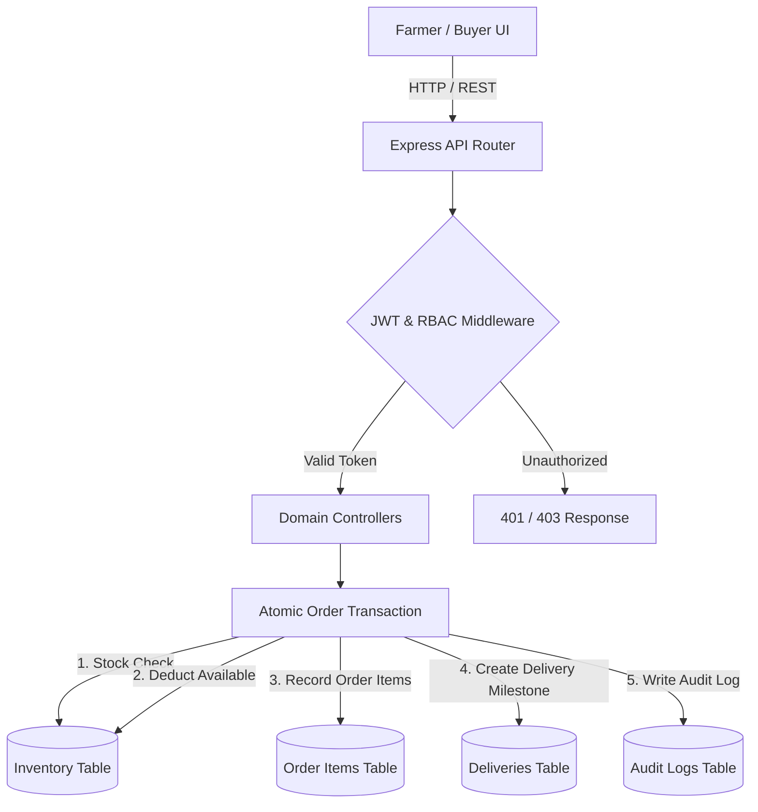

# 🌾 AgriConnect - Direct Farm to Buyer Agricultural Marketplace

[](https://agri-connect-web.onrender.com)
[](LICENSE)
[](#system-architecture)

> **Live Production Website:** [https://agri-connect-web.onrender.com](https://agri-connect-web.onrender.com)  
> **GitHub Repository:** [https://github.com/manikantasai02/agri-intern](https://github.com/manikantasai02/agri-intern)

---

## 📖 About AgriConnect

**AgriConnect** is a digital agribusiness management and harvest trading platform designed to bridge the gap between agricultural producers (farmers/FPOs), bulk buyers/wholesalers, logistics distributors, and platform administrators. 

In traditional agricultural markets, growers face fragmented market prices, heavy exploitation by intermediaries, manual inventory inaccuracies, and lack of real-time shipment transparency. AgriConnect solves these operational bottlenecks by providing:

1. **Direct Farm-Gate Procurement:** Farmers list harvested produce directly at fair, transparent market prices without intermediary exploitation.
2. **Atomic Zero-Overselling Transactions:** Real-time stock reservation prevents race conditions and overselling of agricultural lots.
3. **Escrow Payment Protection:** Payment is verified and held securely in escrow until harvest inspection and consignment delivery.
4. **End-to-End Shipment Telemetry:** Milestone tracking from harvest packaging at farm gate to buyer warehouse delivery.
5. **Farm-Bonding Nature Aesthetic:** Designed with earthy forest greens (`#1b4d3e`, `#2e7d32`), warm creams (`#faf7ee`), floating leaf particle animations, and farm contour vectors that symbolize sustainable agriculture.

---

## 🛠️ Technologies Used

### Frontend Client
* **Framework:** React.js 19 with Vite (blazing fast Single Page Application)
* **Styling & UI:** Tailwind CSS v4 with custom nature color tokens and CSS keyframe animations
* **Icons:** Lucide React
* **Routing:** React Router v7 with declarative route guards and client-side SPA redirects
* **Animations:** Canvas Confetti (celebratory order placement) and SVG leaf floating physics
* **HTTP Client:** Axios with automated JWT Bearer request/response interceptors

### Backend REST API
* **Runtime:** Node.js (v24 LTS)
* **Framework:** Express.js 5 REST API with modular architecture
* **Authentication & RBAC:** JSON Web Tokens (`jsonwebtoken`) with role-based middleware (`farmer`, `buyer`, `distributor`, `admin`)
* **Validation:** Zod v4 schema validation for strict input sanitization
* **Logging & Security:** Morgan HTTP logger, CORS origin filtering, and error shielding (no server stack trace leaks)

### Database & Data Layer
* **PostgreSQL (Supabase Ready):** Full relational schema with foreign key cascades, CHECK constraints (preventing negative quantities/pricing), UUID primary keys, and performance indexing.
* **ACID Transaction Simulator:** Atomic stock check, deduction, order creation, order-item snapshotting, and delivery initialization executed inside single transactional boundaries.

### Deployment & DevOps
* **Host Platform:** Render (Web Services & Static Sites)
* **Infrastructure as Code:** `render.yaml` Blueprint for automated dual-service orchestration
* **SPA Routing:** `_redirects` rule enabling client-side deep linking without 404 errors

---

## 🏗️ System Architecture

AgriConnect follows a modern **three-tier modular monolith architecture** separating presentation, business logic, and transactional persistence:

```
┌─────────────────────────────────────────────────────────────┐
│                 Client: React Responsive SPA                │
│       (Marketplace, Farmer Dashboard, Orders, Admin)        │
└──────────────────────────────┬──────────────────────────────┘
                               │ HTTPS / REST (Bearer JWT)
                               ▼
┌─────────────────────────────────────────────────────────────┐
│                 API Layer: Node.js + Express                │
├─────────────────────────────────────────────────────────────┤
│ ├── Middleware (JWT Auth, RBAC, Zod Validation, CORS)       │
│ ├── Domain Controllers:                                     │
│ │   ├── Auth (Register, Login, Role Binding)                │
│ │   ├── Products (Search, Filter, Pagination, Create)       │
│ │   ├── Orders (Atomic Stock Reservation, Lifecycle)        │
│ │   └── Admin (KYC Verification, Audit Logs, Stats)         │
│ └── Integrated Service Adapters (Logistics & Escrow)        │
└──────────────────────────────┬──────────────────────────────┘
                               │
                               ▼
┌─────────────────────────────────────────────────────────────┐
│            Data Layer: PostgreSQL / Supabase Schema         │
│   (Users, Profiles, Products, Inventory, Orders, Deliveries) │
└─────────────────────────────────────────────────────────────┘
```

### Core Architecture Highlights



---

## 🔑 Pre-Configured Demo Accounts (1-Click Quick Fill)

The live application includes quick-fill buttons on the login screen for testing each persona:

| Role | Email | Password | Primary Permissions |
|---|---|---|---|
| 🧑‍🌾 **Farmer** | `ramesh.farmer@agriconnect.org` | `password123` | Post new crop listings, inspect warehouse volume, accept/reject incoming orders, dispatch harvests |
| 🏢 **Buyer** | `buyer@greenharvest.com` | `password123` | Search marketplace by variety/region, procure lots with escrow, track shipments |
| 🚛 **Distributor** | `logistics@kisanagro.com` | `password123` | Update consignment status (in-transit, delivered), manage transporter fleet |
| 🛡️ **Admin** | `admin@agriconnect.org` | `password123` | Verify/suspend farmer KYC accounts, inspect timestamped immutable audit logs, view platform KPIs |

---

## 💻 Local Development Setup

### Prerequisites
* Node.js v18+ or v24+
* npm v9+

### 1. Clone the Repository
```bash
git clone https://github.com/manikantasai02/agri-intern.git
cd agri-intern
```

### 2. Backend Server
```bash
cd server
npm install
node src/app.js
```
* Backend API runs on: `http://localhost:5000/api/v1`
* Health check: `http://localhost:5000/health`

### 3. Frontend Client
```bash
cd ../client
npm install
npm run dev
```
* Frontend runs on: `http://localhost:5173`

*(On Windows, you can also simply double-click `start.bat` to launch both services simultaneously).*

---

## 🧪 Automated Test Suite

AgriConnect includes a comprehensive automated test suite verifying 14 core positive, negative, and concurrency test scenarios:

```bash
cd server
npm test
```

### Test Coverage Highlights:
* **TC-01:** Health check probe (`GET /health`)
* **TC-02 & TC-03:** User registration & Zod validation rejection
* **TC-04 & TC-05:** Authentication & invalid password rejection
* **TC-06:** Role-Based Access Control (buyers blocked from creating listings)
* **TC-07 & TC-08:** Crop listing creation & rejection of negative prices/quantities
* **TC-09:** Search & multi-parameter catalog filtering
* **TC-10:** Listing ownership isolation (farmers cannot edit other farmers' produce)
* **TC-11 & TC-12:** Atomic order stock reservation & rejection of excess quantities
* **TC-13:** Concurrent race condition prevention under simultaneous order requests
* **TC-21:** Clean error handling without leaking server stack traces

---

## 📄 License
This project is licensed under the MIT License as part of the Yuva Internship Program.
